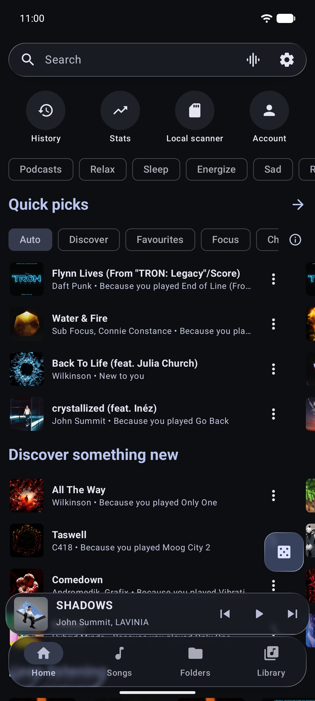
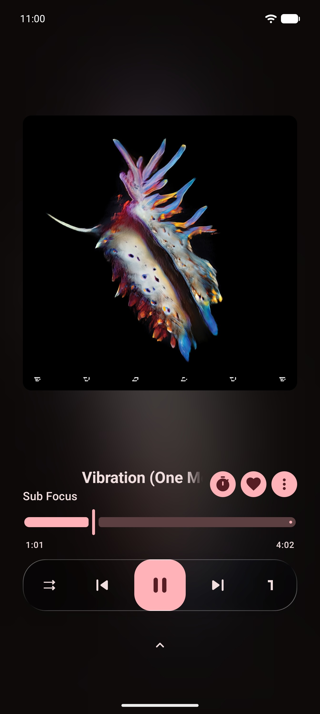
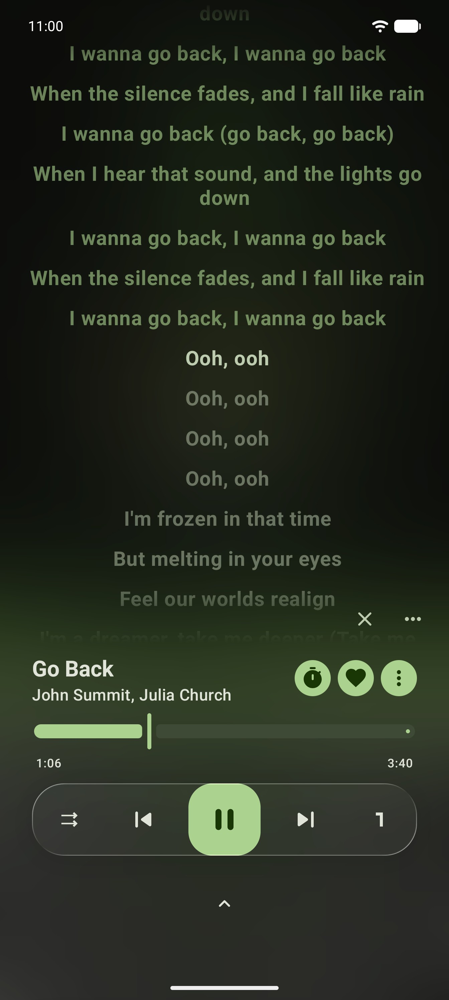
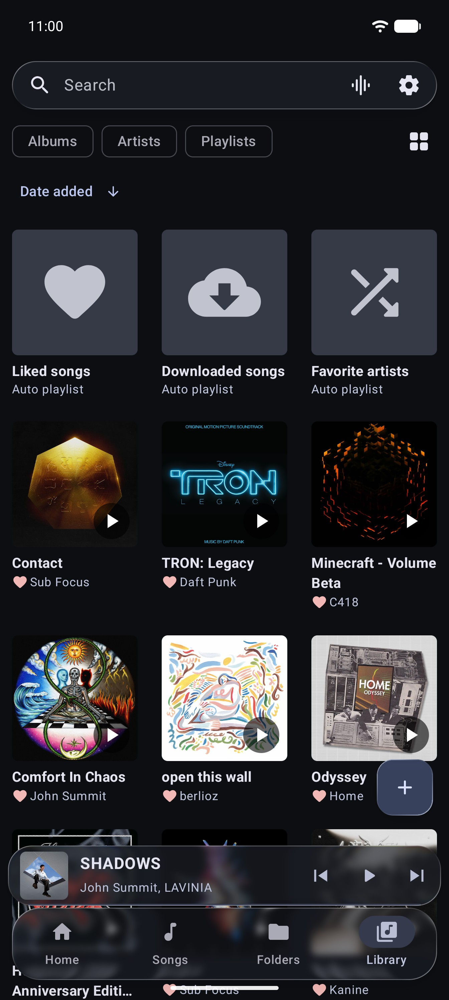
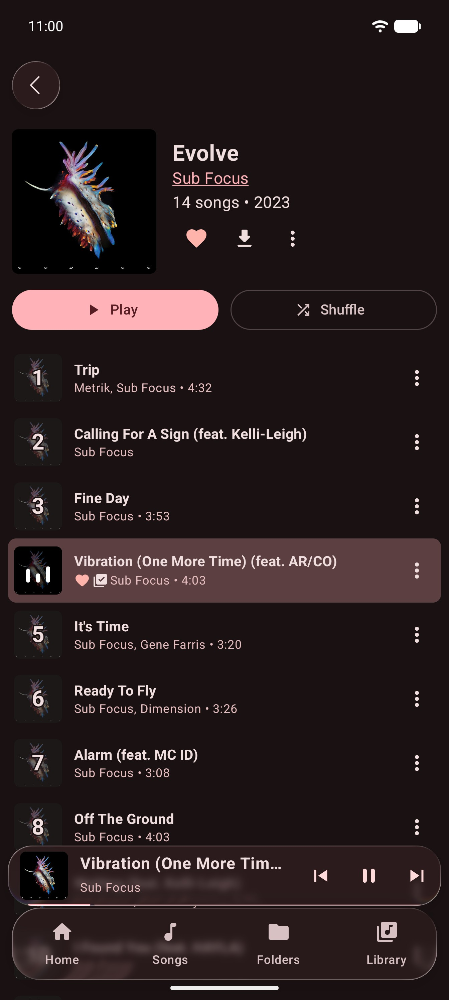
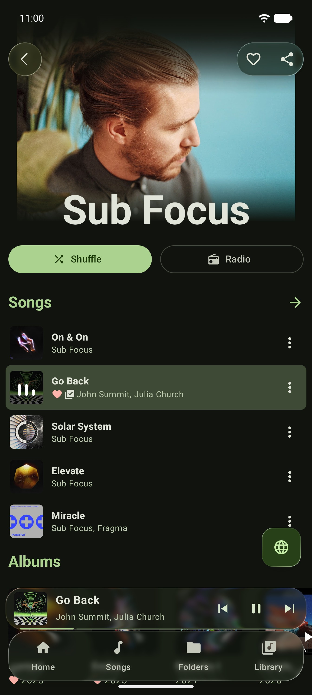

> [!CAUTION]
> From 2027, Google wants Android phones to install only apps from developers registered with it, even outside the Play Store. **[Keep Android Open](https://keepandroidopen.org/)**

<div align="center">


# InterTune

<sub>InnerTune ∩ OuterTune</sub>

### YouTube Music and your own music, in one Android app

[](https://github.com/ItzSkyeYT/InterTune/releases/latest)
[](https://github.com/ItzSkyeYT/InterTune/releases)
[](https://discord.gg/68jmqhMjXk)
[](#donors)
[](https://hosted.weblate.org/engage/intertune/)
[](https://github.com/ItzSkyeYT/InterTune/tree/visionos-fix/LICENSE)
[](https://keepandroidopen.org/)

[Website](https://intertune.app) · [Download](#download) · [Features](#features) · [Good to know](#good-to-know) · [Roadmap](#roadmap) · [Wiki](https://github.com/ItzSkyeYT/InterTune/wiki) · [Discord](https://discord.gg/68jmqhMjXk) · [Contributors](#contributors) · [Donors](#donors)

</div>

InterTune is a free, open-source YouTube Music client for Android, forked from [OuterTune](https://github.com/OuterTune/OuterTune) (which came from [InnerTune](https://github.com/z-huang/InnerTune)). It plays YouTube Music and the music on your phone in one queue, works out recommendations on the phone from what you skip and like, casts to Chromecast, FCast and DLNA, shows synced lyrics, recognises songs and works in Android Auto. No ads, no tracking, no account needed.

> **Warning:** the "InterTune" apps on Google Play and on other APK sites are not this one: they are other companies' apps, with ads. Get InterTune only from this page, Obtainium, F-Droid, Orion Store or OpenAPK.

## Download

<div align="center">

[](https://github.com/ItzSkyeYT/InterTune/releases/latest)
[](https://apps.obtainium.imranr.dev/redirect?r=obtainium://app/%7B%22id%22%3A%22dev.skye.intertune%22%2C%22url%22%3A%22https%3A%2F%2Fgithub.com%2FItzSkyeYT%2FInterTune%22%2C%22author%22%3A%22ItzSkyeYT%22%2C%22name%22%3A%22InterTune%22%2C%22additionalSettings%22%3A%22%7B%5C%22apkFilterRegEx%5C%22%3A%20%5C%22core-release%5C%22%7D%22%7D)<br>
[](https://f-droid.org/packages/dev.skye.intertune/)
[](https://rookieenough.github.io/Orion-Data/redirect.html?id=intertune)
[](https://www.openapk.net/intertune/dev.skye.intertune/)

Android 7.0 or later. Once installed, InterTune updates itself.

</div>

<details>
<summary><b>Android won't install it?</b></summary>

Google wants every Android app to come from a developer who sent them their ID. I won't do that, so your phone will block InterTune until you tell it not to. That's already happening in Brazil, Indonesia, Singapore and Thailand, and everywhere else from 2027. It doesn't matter where the APK comes from: GitHub, Obtainium and F-Droid all get blocked the same way.

Pick whatever fits you:

| Your situation | What to do |
|---|---|
| Just a phone, and waiting a day is fine | Google's switch, steps below |
| Just a phone, but you want it now | [anyapk](https://github.com/sam1am/anyapk), which installs over wireless debugging (Android 11 or newer) |
| You already use Shizuku | Obtainium, with Settings > Installation method set to Shizuku. Updates go in by themselves |
| Rooted | Any root installer, or Shizuku started with root |
| You have a computer | `adb install` the APK, same as always |
| On a ROM without Google's apps (LineageOS, GrapheneOS...) | Nothing, this doesn't touch you |
| InterTune is already installed | It keeps working, only updates get stopped. Sort out one of the above before the next one |

Google's switch:

1. Settings > About phone, tap Build number 7 times
2. Open Developer options and turn on "Allow apps from unverified developers". It'll ask for your PIN and a restart
3. Wait 24 hours (Google's choice, not mine)
4. Go back to that same setting and finish. Pick "indefinitely", the 7 day one runs out after a week

You can switch Developer options back off after that and InterTune still updates.

On a Samsung, Auto Blocker stops installs as well. Turn it off for the install and back on after if you want.

</details>

## Screenshots

<div align="center">






</div>

## Features

<table>
<tr>
<td width="50%" valign="top">

**Playback**

- Listen together: friends hear the same song at the same time, from a code or a QR *(0.13)*
- Songs play to the end, with several ways round it when YouTube refuses a stream
- Songs YouTube gave a new id play again, or are set aside with the reason
- Fade between tracks, and a sleep timer that fades out
- Radios that learn from your skips and likes, and swap in fresh picks
- Cast to a Chromecast, an FCast receiver, a DLNA TV or an AirPlay speaker *(AirPlay in 0.13)*
- The highest audio quality available, with the real codec and bitrate shown

</td>
<td width="50%" valign="top">

**Sound**

- A ten-band equalizer: ready curves, or the one measured for your own headphones (AutoEq)
- Spatial audio on any headphones
- Head tracking where the phone allows it
- Quieter as you walk away from the phone, on Bluetooth headphones
- Volume levelling that works, and a volume slider that goes past 100%
- Varispeed: the pitch follows the speed, like a record *(0.13)*

</td>
</tr>
<tr>
<td width="50%" valign="top">

**Recommendations**

- Best recommendations: Quick picks made on your phone from how you listen
- See why each song is there, and steer the row with dials and moods
- A second row of songs you have never played
- Don't play this song, or block an artist: radios and Shuffle never bring them back *(0.13)*
- A Home without hour-long mixes or previews

</td>
<td width="50%" valign="top">

**Song recognition**

- What's playing? names the song around you, using Shazam, and finds it to play
- Keep listening runs in the background with the screen off
- It can fill a playlist with everything it hears
- It tells a sped-up edit or a remix from the original
- It works offline, and names the song once you're back online *(0.13)*

</td>
</tr>
<tr>
<td width="50%" valign="top">

**Library**

- Import playlists from Spotify, Apple Music, Deezer, Tidal, Amazon Music, SoundCloud, Qobuz or a CSV file
- Bring your whole library over from Metrolist *(0.13)*
- Your own music files beside YouTube Music
- Downloads for offline listening, which can wait for Wi-Fi
- Downloads as MP3, M4A, FLAC or WAV, with the title, artist and cover, at a quality of their own *(0.13)*
- Your playlists, albums and artists in your own order *(0.13)*
- Sync that never loses songs, and scrobbling to ListenBrainz beside Last.fm *(0.13)*
- Automatic backups, a history of every play, and stats that stay on your phone

</td>
<td width="50%" valign="top">

**Lyrics**

- Synced lyrics from LRCLIB and KuGou
- Choose which lyrics sources are used, and in what order *(0.13)*
- Search for other lyrics, or edit them yourself
- Chinese lyrics found in either script
- A line in Latin letters under Japanese (romaji, kanji kept), Korean, Chinese, Russian and more, from Android 10

</td>
</tr>
<tr>
<td width="50%" valign="top">

**Look and feel**

- Liquid glass
- Material You colours from your wallpaper
- A player background that moves with the music
- Layouts for a phone on its side and for tablets
- A home screen widget
- Android Auto with "Hey Google, play"
- Choose what's in the three-dot menus, and how strongly the buttons vibrate *(0.13)*
- A three-page setup, and a page of what is new after each update

</td>
<td width="50%" valign="top">

**Privacy**

- No ads and no tracking
- Updates come through the app and wait for your OK
- Crash reports only if you say yes
- An anonymous install count only if you say yes

</td>
</tr>
</table>

Marked *(0.13)*: coming in the next version.

Every change in detail, and why this fork exists: [docs/FEATURES.md](https://github.com/ItzSkyeYT/InterTune/blob/visionos-fix/docs/FEATURES.md)

## Good to know

- **Coming from OuterTune?** InterTune installs beside it, as `dev.skye.intertune`. Back up in OuterTune (Settings > Backup and restore) and restore the file here.
- **Signing in is optional.** There is a small chance that YouTube restricts or closes an account used with InterTune. Everything works without one.
- **Why playback breaks in other apps**, and what InterTune does about it: [docs/403.md](https://github.com/ItzSkyeYT/InterTune/blob/visionos-fix/docs/403.md)
- **InterTune stands with [Keep Android Open](https://keepandroidopen.org/).** It will not join Google's developer registration, which would tie every Android app to an ID handed to Google.
- If InterTune is useful to you, a star on this page helps other people find the real one.

## Roadmap

What's being worked on, roughly in order. `[x]` is done, `[~]` is built and being tested, `[ ]` is still to do. Nothing here has a date, and plans can change. Ideas are welcome in #feature-requests on [Discord](https://discord.gg/68jmqhMjXk) or as a [GitHub issue](https://github.com/ItzSkyeYT/InterTune/issues/new/choose).

<details>
<summary><b>Next: 0.13</b> · 54 of 57 done, 3 to test</summary>

`[x]` Listen together: one person plays, friends follow the same song in real time\
`[x]` In a room, a guest who casts to a TV or speaker plays on their own, and catches up with the room when the cast ends\
`[x]` Invites to a room keep its code out of the website's logs and out of chat apps' link previews\
`[x]` In a room everyone sees who's picking the music, and the host can hand control to someone and take it back\
`[x]` The host can leave a room without closing it: they hand it to someone and everyone keeps listening\
`[x]` Propose a song to whoever's picking the music, they get a notification with Play it or Not now\
`[x]` Rooms work like a Spotify Jam: guests listen along and can mute, and the host can let everyone control the music\
`[x]` Songs other people add in a room don't change your own recommendations\
`[x]` Songs from your own files play in a room as their YouTube Music version\
`[x]` How rooms work: a short tutorial that also walks you through the room's sheet\
`[x]` AirPlay speakers in the cast list\
`[x]` The equalizer and volume levelling on AirPlay speakers too, and Signal path shows the speaker you cast to\
`[x]` Casting to speakers that only take uncompressed audio, like a Zeppelin Wireless\
`[x]` Don't play this song: radios, autoplay and Shuffle never bring it back ([#78](https://github.com/ItzSkyeYT/InterTune/issues/78))\
`[x]` Pick several songs in the queue and remove them at once\
`[x]` Swipe a song out of the queue, and Undo brings it back ([#141](https://github.com/ItzSkyeYT/InterTune/issues/141))\
`[x]` Block an artist\
`[x]` Your playlists in your own order, dragged where you want them\
`[x]` What's playing works offline and names the song once you're back online ([#48](https://github.com/ItzSkyeYT/InterTune/issues/48))\
`[x]` What you have heard shows each song with its cover and menu, like every other list\
`[x]` Scrobbling to ListenBrainz, beside Last.fm or instead of it ([#159](https://github.com/ItzSkyeYT/InterTune/issues/159))\
`[x]` Albums carry on into a radio when they end\
`[~]` A sleep timer with more ways to stop: at a clock time, or at the end of the song, the album or the queue\
`[x]` Pick a playlist's cover\
`[x]` Downloads other apps can use: .m4a or .opus files with the title, artist and cover\
`[x]` Downloads at a quality of their own, apart from the streaming quality\
`[x]` Downloads as MP3, M4A, FLAC or WAV, at a bitrate that follows what YouTube sent, and Export to folder\
`[x]` Liked songs kept in sync with your downloads: unliking removes a download the app made itself ([#64](https://github.com/ItzSkyeYT/InterTune/issues/64))\
`[x]` A floating dock without the glass on Android 11 and 12\
`[x]` Tempo in 1% steps between 90% and 110%\
`[x]` The playing song stays in view at the top or bottom of a long queue ([#81](https://github.com/ItzSkyeYT/InterTune/issues/81))\
`[x]` Choose which lyrics sources are used, and in what order\
`[x]` Find songs you saved twice, in Liked or your library ([#47](https://github.com/ItzSkyeYT/InterTune/issues/47))\
`[x]` A Widgets page in Settings: each widget on your home screen, how it looks and its main choices\
`[x]` An Animations switch, for older and smaller phones\
`[x]` A short note when the phone's battery saver pauses things like word-by-word lyrics\
`[x]` A radio keeps going when YouTube Music refuses it: other ways to ask, then picks from your own listening\
`[x]` Stats shows how many of the songs you liked InterTune found for you, and where\
`[~]` News, polls and update checks still reach you when GitHub can't be reached\
`[x]` On a weak connection the app waits and tries again before saying YouTube can't be reached, and says it in a small line on Home that local songs never see\
`[x]` Your year in InterTune, a recap\
`[x]` Save your recap as a video to share, with its music\
`[x]` Four more Recap slides from your own year: your seasons, your 2 AM songs, the week you couldn't stop and the one you came back to\
`[x]` Choose what's in the three-dot menus\
`[x]` Arrange the player's buttons by dragging them into boxes shaped like the player's bars\
`[x]` In Classic, the player's three-dots button at the top or at the bottom\
`[x]` A song tapped on the Shelf widget plays without opening the app\
`[x]` Downloaded songs offers to remove the extra copies an old bug left, keeping one file of each\
`[x]` Albums and artists in your own order too\
`[x]` Repeat and shuffle on a lit box when they're on, so off no longer looks greyed out ([#182](https://github.com/ItzSkyeYT/InterTune/issues/182))\
`[x]` The cast button with the player's buttons by the title, where you can move it like them, and a small badge on the mini player during a cast or a room\
`[x]` Remove a song on your phone from the library, or leave out a whole folder, with Undo\
`[x]` A playlist's search looks on YouTube Music too, with an add button on each song\
`[x]` Varispeed: the pitch follows the speed, like a record ([#225](https://github.com/ItzSkyeYT/InterTune/issues/225))\
`[~]` More haptic feedback, and Vibration as Off or five steps on a slider, with the queue ticking like a wheel as you scroll it ([#176](https://github.com/ItzSkyeYT/InterTune/issues/176))\
`[x]` A full-screen tuner for Living blur's colours and movement\
`[x]` Bring your library over from a Metrolist backup, from its Android app or its new one

</details>

<details>
<summary><b>0.14: recommendations rebuilt</b></summary>

`[ ]` One engine for Quick picks, the queue and radios, Home's shelves and Discover, rebuilt from the ground up *(in progress)*\
`[ ]` New signals: the songs you just played, when you skip, what you replay and what you find again yourself\
`[ ]` Learning on your phone that's fair to new songs, starting from what works for many listeners\
`[ ]` The reason for each pick, on a long press\
`[ ]` Testers first, then everyone once it beats today's picks\
`[x]` Similar songs from ListenBrainz, in place of Last.fm\
`[~]` ListenBrainz's playlists made for you on Home, and its picks in Discover\
`[ ]` The player's background on one full-screen page, every style and its settings together\
`[~]` Unison as a lyrics source, with its credit wherever the lyrics show ([#145](https://github.com/ItzSkyeYT/InterTune/issues/145))\
`[ ]` Album and playlist pages redone: a big cover with its details under it, no cover beside each song, your likes and the most played songs marked, and the page in the cover's colours ([#289](https://github.com/ItzSkyeYT/InterTune/issues/289))

</details>

<details>
<summary><b>After 0.13</b></summary>

`[ ]` Premium accounts get the 256 kbps stream\
`[ ]` Lyrics videos\
`[ ]` Better word by word lyrics\
`[ ]` Match your library from another service by logging in to it\
`[x]` A switch to keep Liquid glass's layout, the player and its buttons where they are, drawn without the glass\
`[ ]` The "Group the player buttons" setting goes, the buttons stay grouped as they are by default\
`[ ]` Discord Rich Presence: what you play on your Discord profile, off until you turn it on (it signs in to Discord as you)\
`[ ]` Connect your devices over your Wi-Fi: a phone, watch, TV or tablet as the remote or the speaker, paired once, off until you turn it on *(after 0.14)*\
`[ ]` Paste or share a YouTube link to play it as a song and download it *(0.13.5)*\
`[x]` Speed dial on Home, or Keep listening as before: your pick in Look and feel\
`[x]` Lyrics in big lines, each singer on their own side, with a menu to fix them or pick where they come from\
`[ ]` The queue: radio choices as chips, and a lock\
`[ ]` Roomier settings, and one page for the services InterTune connects to\
`[x]` Playlist folders\
`[x]` Living blur in your own colours for a song, one to five, picked from its cover\
`[ ]` Music videos ([#96](https://github.com/ItzSkyeYT/InterTune/issues/96))\
`[ ]` Bring your library over from InnerTune, ViMusic, SimpMusic or Kreate\
`[~]` A thumbs down that YouTube Music hears too, then a Dislike button in the notification ([#171](https://github.com/ItzSkyeYT/InterTune/issues/171))\
`[x]` NetEase Cloud Music as a lyrics source, for more word by word lyrics\
`[x]` Lock a room so no one new can join, even with the code\
`[~]` Emoji reactions in a room\
`[ ]` Lyrics translated by AI with your own key, if you turn it on ([#177](https://github.com/ItzSkyeYT/InterTune/issues/177))\
`[ ]` A page with every poll, to see or change what you answered\
`[ ]` Music to a speaker of your choice while a call stays on the phone ([#117](https://github.com/ItzSkyeYT/InterTune/issues/117))\
`[~]` InterTune's own screen on Chromecasts, with Google Home's Next button working\
`[~]` Spatial audio for surround recordings, and Strength, Room and Ambience controls\
`[~]` Similar artists in the Favourite artists mix\
`[ ]` Tablets: settings in two panes, and the player as a side pane that can show lyrics *(in progress)* ([#140](https://github.com/ItzSkyeYT/InterTune/issues/140))\
`[ ]` A look made for foldable and flip phones *(in progress)*\
`[ ]` Play or shuffle the whole Quick picks row from its title\
`[ ]` Your own songs: an artist or genre with & or a comma in its name stays whole

</details>

<details>
<summary><b>Later</b></summary>

`[ ]` Mix: songs in a playlist blend into each other like a DJ set, with an editor to shape each change *(in progress)*\
`[~]` A filter for AI-made songs (the poll in #general said yes)\
`[ ]` Share a playlist you made with a link that opens it in InterTune\
`[ ]` Your library in sync with YouTube Music both ways, changes made offline sent when you're back\
`[ ]` Copy your library to another YouTube account\
`[ ]` AirPlay 2 speakers\
`[ ]` A web player, to listen from a computer's browser\
`[ ]` A Wear OS app: a remote for your phone, and music on the watch itself *(in progress)*\
`[ ]` What you're playing on your Discord profile *(being looked at)*\
`[ ]` Animations reworked to feel even smoother

</details>

## Translations

InterTune is translated on [Weblate](https://hosted.weblate.org/engage/intertune/). The chart below shows how far each language is, and every one of them can use a hand.

<a href="https://hosted.weblate.org/engage/intertune/"></a>

Spotted a wrong translation? Fix it on Weblate, or [say so here](https://github.com/ItzSkyeYT/InterTune/issues/new?template=translation_report.yml).

## Building

```bash
git clone --recurse-submodules https://github.com/ItzSkyeYT/InterTune.git
cd InterTune
./gradlew assembleCoreDebug
```

JDK 21 and an Android SDK with `platforms;android-36`, `ndk;29.0.13113456` and `cmake;3.31.6`. The submodules matter: `taglib` pulls its own, and the build fails without them.

## Star history

<a href="https://www.star-history.com/?repos=itzskyeyt%2Fintertune&type=date&legend=top-left">
 <picture>
   <source media="(prefers-color-scheme: dark)" srcset="https://api.star-history.com/chart?repos=itzskyeyt/intertune&type=date&theme=dark&legend=top-left" />
   <source media="(prefers-color-scheme: light)" srcset="https://api.star-history.com/chart?repos=itzskyeyt/intertune&type=date&legend=top-left" />
   
 </picture>
</a>

Thank you so much, everyone, for your support in this growing project!

## Contributors

<p align="center">People whose code is in InterTune. Thank you for building it with me!</p>

<p align="center"><a href="https://github.com/3SSF"></a><br><b><a href="https://github.com/3SSF">3SSF</a></b><br><sub>The first code from outside: a music note on local songs with no cover (<a href="https://github.com/ItzSkyeYT/InterTune/pull/161">#161</a>) · November 2026</sub></p>

<p align="center"><b>Translators</b><br>InterTune speaks your language thanks to everyone translating it on <a href="https://hosted.weblate.org/engage/intertune/">Weblate</a>, and especially <b>Mickaël Binos</b> (French) and <b>Jacek Krewniak</b> (Polish). Thank you!</p>

<p align="center"><b>Want to help?</b> <a href=".github/CONTRIBUTING.md">CONTRIBUTING.md</a> says how to build it, and the <a href="https://discord.gg/68jmqhMjXk">Discord server</a> is the place to ask for a first task.</p>

## Donors

<p align="center">InterTune is free and has no ads. These people gave something back anyway, and that keeps the project going. It means a lot, <b>thank you!</b></p>

<p align="center"><br><b>Dismorphism</b><br><sub>The very first donation · October 2026</sub></p>

<p align="center"><br><b>Ti-Die</b><br><sub>The first on Ko-fi · November 2026</sub></p>

<p align="center"><br><b>frances</b><br><sub>Gave on Ko-fi · November 2026</sub></p>

<p align="center"><br><b>Geogos</b><br><sub>The first on PayPal · November 2026</sub></p>

<p align="center"><br><b>Tortouli (TortonT on bbo)</b><br><sub>Gave on Ko-fi · November 2026</sub></p>

<p align="center"><sub>Some donors chose not to be named here. Thank you to them too.</sub></p>

<!-- The app's About > Support InterTune and the site read the donors' names from this table (utils/Donors.kt, tools/site/build.py):
     one cell a donor, the name in bold first. A new donor goes in both here and above.
<table><tr><td><b>Dismorphism</b></td><td><b>Ti-Die</b></td><td><b>frances</b></td><td><b>Geogos</b></td><td><b>Tortouli (TortonT on bbo)</b></td></tr></table>
-->

<br>

<p align="center"><a href="https://ko-fi.com/intertune"></a></p>

<p align="center"><b>Want your name here?</b> Give on <a href="https://ko-fi.com/intertune">Ko-fi</a> and say so in your message, or tell me on the <a href="https://discord.gg/68jmqhMjXk">Discord server</a>! Prefer crypto? Message me on Discord.</p>

## Special thanks

InterTune stands on a lot of other people's work.

#### Where it comes from

| Project | By | For |
|---|---|---|
| [InnerTune](https://github.com/z-huang/InnerTune) | [Zion Huang](https://github.com/z-huang) | The app it all started from |
| [OuterTune](https://github.com/OuterTune/OuterTune) | [Michael Zh](https://github.com/mikooomich) · [Davide Garberi](https://github.com/DD3Boh) | The fork InterTune is built on, where the most work is from |
| [AsterTune](https://github.com/yuuichi-s/AsterTune) | [yuuichi-s](https://github.com/yuuichi-s) | The same `VISIONOS` fix, found on their own; how a signed-in play reaches the right channel's YouTube history follows its request (6ea96c90), and the po token page works the way its does |
| [Metrolist](https://github.com/MetrolistGroup/Metrolist) | [MetrolistGroup](https://github.com/MetrolistGroup) | A lot of inspiration, this README included |
| [Essentials](https://github.com/sameerasw/essentials) · [sameerasw.com](https://sameerasw.com) | [Sameera Wijerathna](https://github.com/sameerasw) | The design language the app and its site learn from |

#### Libraries and data

| Project | By | For |
|---|---|---|
| [AndroidLiquidGlass](https://github.com/Kyant0/AndroidLiquidGlass) | Kyant0 | Liquid glass (`io.github.kyant0:backdrop`, Apache-2.0) |
| [SongRec](https://github.com/marin-m/SongRec), through the `songrecfp` crate in [Audile](https://github.com/AudileTeam/Audile) | marin-m, Aleksey Saenko | The Shazam fingerprint behind song recognition, ported to Kotlin (both GPL-3.0) |
| SADIE, from Google's [Resonance Audio](https://github.com/resonance-audio/resonance-audio) | The University of York's Audio Lab | The ear responses behind spatial audio (Apache-2.0, licence in [docs/hrtf](https://github.com/ItzSkyeYT/InterTune/blob/visionos-fix/docs/hrtf/LICENSE.SADIE)) |
| [ICU](https://icu.unicode.org) | Unicode | Matching Traditional and Simplified Chinese lyrics (Unicode License v3, notice in [docs/licenses](https://github.com/ItzSkyeYT/InterTune/blob/visionos-fix/docs/licenses/ICU-Unicode-3.0.txt)) |

#### People

| Who | For |
|---|---|
| [rii2609](https://github.com/rii2609) | The idea for Liquid glass |
| Everyone who [reports issues](https://github.com/ItzSkyeYT/InterTune/issues) | Finding what needs fixing, as well as great ideas |
| Everyone translating on [Weblate](https://hosted.weblate.org/engage/intertune/) | InterTune in your language |

## Licence

GPL-3.0-only. See [LICENSE](https://github.com/ItzSkyeYT/InterTune/tree/visionos-fix/LICENSE).

Forking InterTune? Read the [fork rules](docs/FORKS.md) first: they apply before you share a single build.

<details>
<summary>Why "only"</summary>

The file headers say `GPL-3.0`, which SPDX deprecated because it does not say whether a later version of the licence may be used. They come from upstream, and a fork cannot hand out a permission its upstream never gave, so the project reads them the conservative way: version 3, and version 3 only. If OuterTune or InnerTune ever say otherwise, this follows them.

</details>

Copyright © 2024 z-huang/InnerTune<br>
Copyright © 2025 OuterTune Project<br>
Copyright © 2026 ItzSkyeYT
